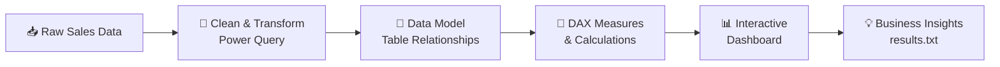

<div align="center">

# 🛒 E-Commerce Sales Dashboard

### An interactive Power BI dashboard that turns raw online-store data into clear, actionable business insights.

<br>


<br>

[📊 Overview](#-overview) •
[✨ Features](#-key-features) •
[🖼️ Preview](#️-dashboard-preview) •
[🛠️ Tech Stack](#️-tech-stack) •
[🚀 Getting Started](#-getting-started) •
[📈 Insights](#-business-questions--insights) •
[🎓 Learnings](#-project-learnings)

</div>

---

## 📊 Overview

This project is an **interactive Power BI dashboard** built for an E-commerce store. It analyzes online sales data to answer key business questions such as:

- 💰 *How much revenue and profit is the store generating?*
- 📦 *Which products and categories perform best?*
- 🌍 *Which regions and customer segments drive the most sales?*
- 📅 *How do sales trend across months and years?*

All findings and answers derived from the dashboard are documented in the **`results.txt`** file included in this repository.

> 💡 **Who is this for?** Anyone who wants a practical, hands-on starting point for learning how to **analyze data and build dashboards with Power BI**.

---

## ✨ Key Features

| Feature | Description |
|---|---|
| 🎛️ **Interactive Filtering** | Slicers and filters let users slice data by date, category, region, and more |
| 🔍 **Drill-Down Analysis** | Explore from high-level summaries into detailed, granular views |
| 🧮 **Custom Calculations** | Calculated columns and measures built to manipulate and enrich the data |
| 🔗 **Data Modeling** | Multiple tables connected and joined into a clean relational model |
| ⚙️ **User-Driven Parameters** | Dynamic parameters that change visualizations based on user choices |
| 🎨 **Rich Visuals** | A wide variety of customized chart types for different analytical needs |

---

## 🖼️ Dashboard Preview

> 📌 **Add your screenshots here** — place images inside an `images/` folder and update the paths below.

<div align="center">


*Main dashboard overview*

</div>

<details>
<summary><b>📸 View more screenshots</b></summary>
<br>

| Sales Overview | Product Analysis |
|:---:|:---:|
|  |  |

| Regional Analysis | Customer Insights |
|:---:|:---:|
|  |  |

</details>

---

## 📉 Visualizations Used

This dashboard showcases a broad range of Power BI visuals:

- 📊 **Bar Charts** & **Clustered Bar Charts** — compare categories and segments
- 🥧 **Pie Charts** & 🍩 **Donut Charts** — show proportional contribution
- 🔵 **Scatter Charts** — reveal relationships between metrics
- 📈 **Line Charts** — track trends over time
- 🏔️ **Area Charts** — visualize cumulative growth
- 🗺️ **Maps** — geographic distribution of sales
- 🎚️ **Slicers** — interactive, user-driven filtering

---

## 🛠️ Tech Stack

| Tool | Purpose |
|---|---|
|  | Dashboard design & visualization |
|  | Measures & calculated columns |
|  | Data connection, cleaning & transformation |

---

## 📁 Repository Structure

```text
E-commerce-Sales-Dashboard/
│
├── 📄 README.md          # Project documentation (you are here)
├── 📄 results.txt        # Insights & answers derived from the dashboard
├── 📊 *.pbix             # Power BI dashboard file (if included)
└── 🖼️ images/            # Dashboard screenshots (optional)
```

---

## 🚀 Getting Started

### ✅ Prerequisites

- **Microsoft Power BI Desktop** (free) — [Download here](https://powerbi.microsoft.com/desktop/)
- A Windows PC *(Power BI Desktop is Windows-only)*

### 📥 Installation & Usage

**1️⃣ Clone the repository**

```bash
git clone https://github.com/Nameis-nilesh/E-commerce-Sales-Dashboard.git
```

**2️⃣ Navigate into the project folder**

```bash
cd E-commerce-Sales-Dashboard
```

**3️⃣ Open the dashboard**

Open the `.pbix` file with **Power BI Desktop**.

**4️⃣ Explore!**

Use the slicers, filters, and drill-down options to interact with the data.

---

## 📈 Business Questions & Insights

The dashboard was built to answer a defined set of questions about the store's performance. The complete findings are available in 👉 **[`results.txt`](./results.txt)**.



---

## 🎓 Project Learnings

Building this project helped me develop and strengthen the following skills:

- ✅ Created an **interactive dashboard** to track and analyze online sales data
- ✅ Used **complex parameters** to drill down in worksheets, with customization through **filters and slicers**
- ✅ Created **connections**, joined new tables, and performed **calculations** to manipulate data
- ✅ Enabled **user-driven parameters** for dynamic visualization
- ✅ Designed **multiple customized visualizations** — bar, pie, donut, clustered bar, scatter, line, area, map, and slicers

---

## 🏁 Conclusion

The project successfully answered the set of questions about the **E-commerce store's performance**, delivering a clear, interactive view of sales data. Detailed results can be found in the [`results.txt`](./results.txt) file.

This repository can serve as a **starting point for anyone learning Power BI** and wanting to build real-world analytics dashboards.

---

## 🙏 Credits

This project was inspired by a pivotal learning resource:

[](https://youtu.be/6cV3OwFrOkk)

---

## 🤝 Contributing

Contributions, suggestions, and improvements are welcome!

1. 🍴 Fork the repository
2. 🌿 Create a new branch (`git checkout -b feature/your-feature`)
3. 💾 Commit your changes (`git commit -m "Add your feature"`)
4. 📤 Push to the branch (`git push origin feature/your-feature`)
5. 🔁 Open a Pull Request

---

## 📬 Contact

<div align="center">

**Nilesh** — [@Nameis-nilesh](https://github.com/Nameis-nilesh)

[](https://github.com/Nameis-nilesh)

<br>

⭐ **If you found this project helpful, please consider giving it a star!** ⭐

</div>
